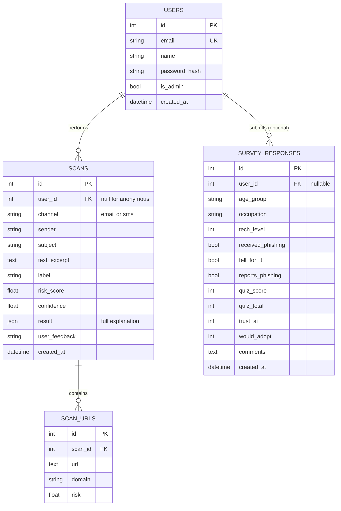
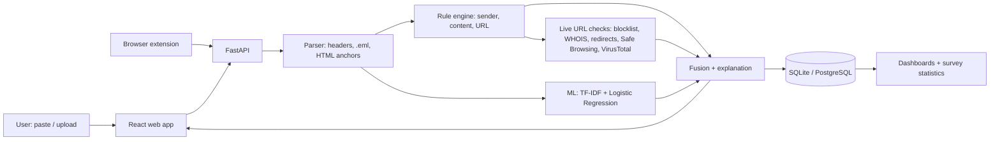

# 2. Software requirements specification (SRS)

## 2.1 Purpose and users
| Actor | Goal |
|---|---|
| Visitor | Check a message quickly without signing up |
| Registered user | Keep history, see "threats caught" dashboard, rate verdicts |
| Survey participant | Complete the awareness survey (signed in or anonymous) |
| Admin | See aggregate threat trends, model status, survey statistics |

## 2.2 Functional requirements
| ID | Requirement | Module |
|---|---|---|
| FR1 | Accept pasted email/SMS text, optional sender/subject, and `.eml`/`.txt` upload (max 2 MB) | Input |
| FR2 | Parse pasted headers (From, Subject, Reply-To) automatically | Input |
| FR3 | Return verdict (legitimate / suspicious / phishing), 0-100 risk score, and ML confidence | Core |
| FR4 | Explain with named signals, each with severity, plain-language detail and evidence | Explainability |
| FR5 | Highlight triggering phrases and links inside the original message | Explainability |
| FR6 | Show word-level contribution of the ML model | Explainability |
| FR7 | Analyse every URL: IP host, shortener, punycode, `@`, look-alike/brand misuse, TLD, subdomains, HTTPS, blocklist | URL checker |
| FR8 | Optional live checks: WHOIS domain age, redirect chain, Google Safe Browsing, VirusTotal (fail open) | URL checker |
| FR9 | Sender checks: display-name/domain mismatch, free-mail brand claims, Reply-To mismatch, look-alike domains | Heuristics |
| FR10 | Register / sign in (JWT); anonymous scanning allowed | Auth |
| FR11 | Save scans with a "don't save" option; list, view, delete own history | History |
| FR12 | Personal dashboard: threats caught, verdict mix, top red flags, 30-day trend | Analytics |
| FR13 | User can rate a verdict correct/incorrect | Feedback |
| FR14 | Awareness survey with scored quiz (answers checked server-side) | Survey |
| FR15 | Survey statistics: descriptives, Spearman correlations, Mann-Whitney U | Survey |
| FR16 | Admin dashboard: totals, trends, common patterns, risky domains, score distribution, model info | Admin |
| FR17 | Browser extension: context-menu scan, popup, inline Gmail button | Extension |

## 2.3 Non-functional requirements
| ID | Requirement | How it is met |
|---|---|---|
| NFR1 | Response under 2 s without live URL checks | Linear model + regex rules; no network by default |
| NFR2 | Privacy | Optional saving; stored text truncated to 5,000 chars; users only see their own scans; survey stored without identity in stats |
| NFR3 | Resilience | Every network check has a 5 s timeout and fails open |
| NFR4 | Security | PBKDF2-SHA256 (200k iterations), JWT, role check on admin routes, input length limits, upload type/size limits |
| NFR5 | Explainability | Rule signals are first-class; ML explanation is exact for a linear model |
| NFR6 | Accessibility | Keyboard focus rings, labelled controls, reduced-motion support, responsive layout |
| NFR7 | Portability | SQLite for development, PostgreSQL via one environment variable; Docker Compose |

## 2.4 Tools and technologies
| Layer | Choice | Notes |
|---|---|---|
| Frontend | React 18 + Vite, React Router, Chart.js | Web dashboard |
| Extension | Chrome Manifest V3 (plain JavaScript) | Works in Chromium browsers |
| Backend | FastAPI (Python 3.12), SQLAlchemy 2 | Auto-generated API docs at `/docs` |
| ML | scikit-learn: TF-IDF + Logistic Regression | Linear, so explanations are exact |
| Explainability | Linear-model attributions (`coef x tf-idf`, equal to linear SHAP) | LIME/SHAP libraries not needed for this model class |
| Security services | python-whois, Google Safe Browsing API, VirusTotal API, PhishTank | Optional, key-based |
| Database | SQLite (dev) / PostgreSQL (prod) | MongoDB not used: data is relational |
| Testing | pytest + FastAPI TestClient | 16 tests |

## 2.5 Data and API sources
| Source | Use | Status |
|---|---|---|
| phishing_pot, Smishtank, SpamAssassin, UCI SMS, NUS SMS | Real training data (19,292 cleaned messages) | Collected and cleaned (`docs/05_dataset.md`) |
| Phishing.Database | Live phishing-domain feed (about 386k) for the URL checker | Included; refresh with `pipeline.collect` |
| Synthetic templates (`app/ml/dataset.py`) | Offline fallback; small tagged patch for modern legit mail and link-less scams | Included |
| Kaggle, PhishTank, OpenPhish | Extra data | Not reachable in the build environment; add CSVs to `backend/data/raw/` |
| UCI Phishing Websites | Optional future URL-feature model | Not wired in |
| Google Safe Browsing / VirusTotal | Live URL reputation | Set API keys in `.env` |

## 2.6 Entity-relationship diagram

## 2.7 Architecture

**Fusion rule:** risk = 0.5 x ML risk + 0.5 x rule risk. Rule signals combine by noisy-OR (many weak signals add up with diminishing returns). A blocklist or Safe Browsing hit forces risk to at least 92; a rule score of 75 or more lifts the final score to at least 90% of it. Verdict thresholds: below 30 legitimate, 30-59 suspicious, 60 and above phishing.

## 2.8 Module breakdown
| # | Module | Files | Phase |
|---|---|---|---|
| M1 | Input and parsing | `services/analyzer.py` (`parse_message`, `parse_eml`) | Core |
| M2 | Rule engine | `services/heuristics.py` | Core |
| M3 | URL safety | `services/url_checker.py`, `data/blocklist.txt` | Core |
| M4a | Data pipeline | `pipeline/collect.py`, `pipeline/clean.py` | Main |
| M4 | ML classifier | `ml/dataset.py`, `ml/preprocess.py`, `ml/train.py`, `services/ml.py` | Main |
| M5 | Explainability | `services/ml.py` (`explain`), highlights in `analyzer.py` | Main |
| M6 | Auth and history | `auth.py`, `routers/auth.py`, `routers/scans.py` | Core |
| M7 | Survey and statistics | `routers/survey.py` | Core |
| M8 | Analytics dashboards | `routers/admin.py`, `frontend/src/pages/{Dashboard,Admin}.jsx` | Dashboard |
| M9 | Web UI | `frontend/` | Core |
| M10 | Browser extension | `extension/` | Optional |

## 2.9 REST API summary
| Method | Path | Auth | Purpose |
|---|---|---|---|
| POST | `/api/scan` | optional | Scan pasted text |
| POST | `/api/scan/upload` | optional | Scan `.eml` / `.txt` |
| GET | `/api/scans`, `/api/scans/{id}` | user | History |
| GET | `/api/scans/stats/me` | user | Personal dashboard data |
| PATCH | `/api/scans/{id}/feedback` | optional | Rate a verdict |
| DELETE | `/api/scans/{id}` | user | Delete a scan |
| GET / POST | `/api/survey/questions`, `/api/survey` | optional | Survey |
| GET | `/api/survey/stats` | admin | Survey statistics |
| GET | `/api/admin/overview` | admin | Aggregate threat analytics |
| POST | `/api/auth/register`, `/login`; GET `/me` | none / user | Accounts |
